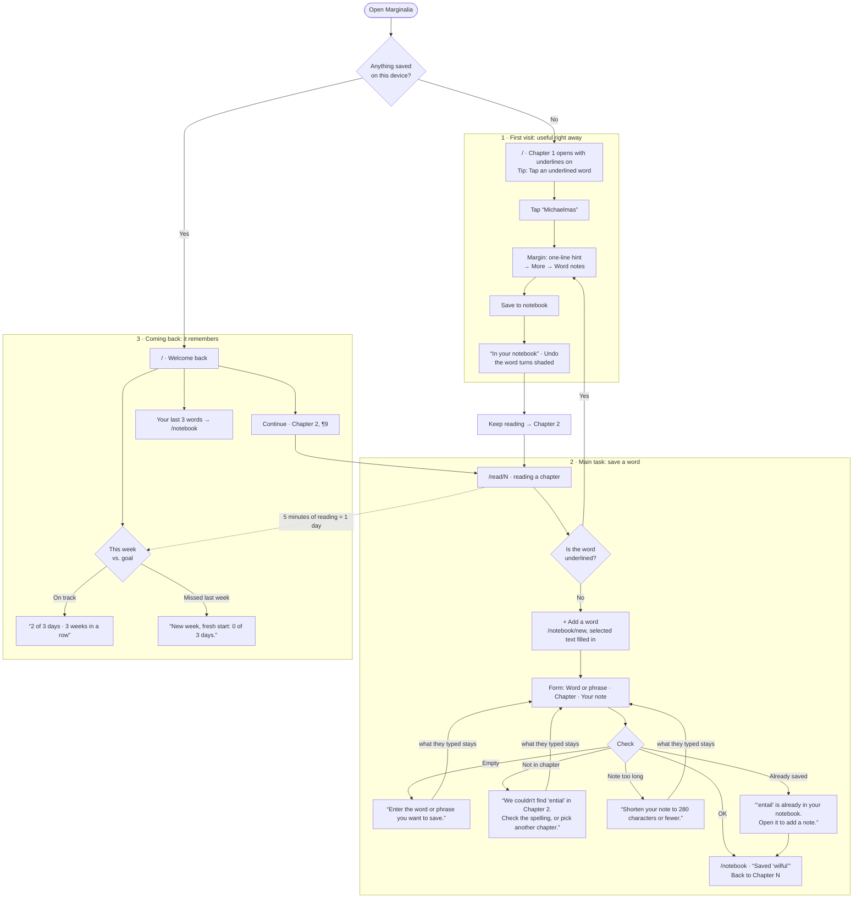

# Marginalia

**Read *Pride and Prejudice* with a guide in the margin.** Tap a word or a detail a modern reader
doesn't know, see what it meant in 1813, and save it to your notebook. Come back to pick up where
you stopped and keep a weekly reading goal. Everything stays in your browser; there's no account.

- **Live:** https://marginalia-kappa-beryl.vercel.app/
- **Code:** https://github.com/Rogernarten/marginalia

Design, Build, Ship · Assignment 3: Patterns & Flows.

## Who it's for

Someone who wants to read the classics in English but keeps tripping over two kinds of things:
words that have changed meaning (*want*, *design*, *tolerable*) and customs nobody explains any
more (why Mr. Bennet has to visit first, what “four or five thousand a year” means). Ordinary
reading apps give a dictionary definition or a straight translation. This gives a short hint
first and more on request, written for a reader of 1813, and never just translates.

The first idea was an app that explains any passage with AI on demand. This week's brief allows no
external APIs, so the hints are written ahead of time and shipped as data: 61 hand-checked notes
on Chapters 1 to 3. The whole book (all 61 chapters) can be read, and any word in any chapter can
be saved with your own note.

## The main flow

> I tap a word I don't know → I see what it meant in 1813 and save it to my notebook →
> I come back on Sunday, see my week, and pick up where I stopped.



The same diagram, with the states table, lives in [`flows.md`](flows.md).

### Pages

Each step of the flow is its own route, with the same navigation on every page (Read, Notebook
with a word count, and the title back to the start).

| Route | Step |
|---|---|
| `/` | **First visit:** Chapter 1, with notes ready. **Coming back:** Welcome back (decided once, on load) |
| `/read` | Contents, with Continue and “You're here” |
| `/read/[chapter]` | Reading, with the margin; offers to jump back to where you stopped |
| `/notebook/new` | The form: save a word |
| `/notebook` | Your words, by chapter |

## First visit

**What someone new sees:** a one-line promise (“Read it with a guide in the margin”), then
Chapter 1 itself, with words already underlined. One tap on *Michaelmas* shows a hint in the
margin (a bottom sheet on phones), and one more saves it. There's no sign-up, no tour and no empty
screen: the book is the onboarding.

**Research.** Subagents studied how three reading tools welcome someone new:

| Tool | First screen | What we took or avoided |
|---|---|---|
| Kindle | Sign in, then an empty library; Word Wise has to be switched on | Avoid the empty start. Its auto-picked hints define easy words and miss period ones, so our hard words are chosen by hand |
| LingQ | Sign-up and 4–5 setup screens before reading | Avoid the wall. Copy: color words by state (new, saved) and save the sentence with each word |
| 微信读书 (WeChat Read) | Books chosen for you; a shared link opens straight into the text | Copy: open on the text itself, one tap menu, notes that jump back to the passage. Avoid strict streaks and pop-ups during reading |

All three pointed the same way: open on Chapter 1 with notes already on, ask for nothing first,
and keep goals forgiving.

## The form

`/notebook/new` saves any word, even in chapters with no notes. One column: **Word or phrase**,
**Chapter**, and **Your note (optional)**. Select a word in the text before pressing **+ Add a
word** and it's filled in. The word is checked against the chapter's real text, so the notebook
only holds words that are actually there, spelled the way the book spells them (typing
*tomorrow* saves *To-morrow*), with the sentence attached automatically.

Errors sit under their field, say what to do next, and keep what you typed:

| When | The message |
|---|---|
| Nothing typed | Enter the word or phrase you want to save. |
| Not in that chapter | We couldn't find “ential” in Chapter 2. Check the spelling, or pick another chapter. |
| Already saved | “entail” is already in your notebook. Open it to add a note. (with a link) |
| Note too long | Shorten your note to 280 characters or fewer (now 312). |

Focus moves to the first field with an error; after the first try, fields re-check when you
leave them. An unfinished form is kept as a draft (“We kept what you typed last time.”).

## Coming back

**What brings someone back:** the book itself (picking up mid-chapter) and a weekly reading goal
that's hard to fail. A day counts after five minutes of real reading (the tab visible, and you
scrolled, tapped or pressed a key in the last 90 seconds). The goal is days per week (3 by
default, 1 to 7), and the streak counts **weeks** in a row, so missing a day never breaks it.

**Welcome back** shows, in this order: where you stopped (chapter, paragraph and its first words,
with Continue), this week as seven days with check marks, and your latest words. If last week fell
short, it says “New week, fresh start: 0 of 3 days.” and nothing more: no guilt, no pop-ups. Your
saved words stay shaded in the text when you read again, and opening one shows your note.

**What it remembers** (one localStorage key, `marginalia:v1`):

| Saved | Used for |
|---|---|
| Words: the word, chapter, paragraph, sentence, your note, the hint it came from | Notebook, shading in the text, latest words |
| Position: chapter and paragraph | Continue, “You stopped at paragraph 15”, “You're here” |
| Seconds read per day | This week, streaks |
| Weekly goal | This week |
| Form draft | Keeping what you typed |

If the browser won't save (private mode, a full disk), a banner says so instead of silently
losing words.

## Accessibility

Everything works with a keyboard, every field has a real label, and every color pair was checked
for contrast. Full details, the contrast table and the keyboard map:
[`docs/accessibility.md`](docs/accessibility.md).

- axe-core (WCAG 2.2 AA) on 11 pages and states: 0 violations
- Every Tab stop on six pages is visible with a focus ring; a whole visit works without a mouse
- No sideways scrolling at 320px
- Text contrast from 5.7:1 to 15.2:1; underlines, borders and focus rings at least 3.6:1

## First-run check

Once the site was live, a fresh agent with no access to the code or this conversation got the URL
and a goal: *“I'm reading Pride and Prejudice in English for a class and keep tripping over
old-fashioned words. Save three words I didn't know from Chapter 1, with a note on at least one.”*
It used the site in Chrome at 1440px and 390px and with the keyboard alone, then shifted its saved
dates back eight days and came back “a week later”.

**First impression, in its words:** “It was clear right away… an annotated Pride and Prejudice
where I tap underlined words. The text of Chapter 1 is on the home page, so I knew what to do at
once.”

**What worked for it:** the hint card with More, saving in one click, the count in the navigation,
saved words shaded in the text, a selected word carried into the form, specific error messages,
and “Open in Chapter 1” landing on the right paragraph. Keyboard use was “very good”. Coming back,
it was greeted with “Welcome back. New week, fresh start: 0 of 3 days.”, and Continue took it to
the exact paragraph: “Picking up was obvious.”

**What it found, and what I changed:**

| Found | Changed |
|---|---|
| After fixing a misspelling, the first click on Save did nothing: the error cleared on blur, Save jumped up about 48px, and the click missed. The old error also stayed up while typing | Errors re-check while you type (after a short pause), never on blur and never mid-click. One click saves |
| In the margin, “Undo” sat next to “Edit note” and deleted the word and its note; Remove had no undo | After saving: Add a note and Remove. Remove leaves an Undo that brings the word back with its note |
| The word whose note was open turned the same yellow as saved words, so unsaved words looked saved | The open word gets an ink ring. Yellow means saved and nothing else; hover is a pale tan |
| The sentence saved with *caprice* ran on into the next one | Sentences that start with an italic word (*Her*) now split correctly |
| After a second save, the notebook didn't scroll to the new word | It scrolls to and highlights every newly saved word |
| “Open it to add a note” even when the word already had a note | It says “Open it to see your note” then |
| With More open, the margin ran past the bottom of the screen and hid Save note | The margin fits the screen and scrolls inside |

**Heard, and kept for the next version.** I fixed every bug first; these are the bigger changes
it suggested:

- Saving a word that isn't underlined is slow: select it, scroll back to **+ Add a word** at the
  top, then land in the notebook. Its top request was a Save button right at the selection.
- When a word isn't in the chosen chapter, search the whole book (“It's in Chapter 1”).
- On a phone, the sheet can cover the word you tapped, and the phone legend leaves out the
  + Add a word hint.
- Welcome back doesn't say when you last read, and Tab reaches the weekly goal before your latest
  words.
- The weekly goal is the only nudge to return; it wanted review and export of saved words. When
  planning I chose picking up the book and a reading goal over flashcards, so review is the next
  feature I'd add.

## How I worked with the agent

Everything was built by directing Claude Code, in steps with a checkpoint after each one, and the
commit history follows those steps.

**Decisions I made:**

- The idea, and adapting it when the brief ruled out APIs: hints written ahead of time instead of
  on demand.
- *Pride and Prejudice* in English (over Homer): it's English in the original, so the language
  notes teach real English.
- Which tools to research, including 微信读书.
- What brings people back: picking up where you stopped and a weekly goal with streaks, not
  flashcard review.
- Reopening a chapter offers a jump (“You stopped at paragraph 15 · Jump there”) instead of
  scrolling by itself; Continue goes straight there.
- After using it, I asked why my own notes didn't show in the text the way the hints do. The agent
  had left self-saved words as plain shading; now they open like hints, with the note editable in
  place.

**What testing caught.** The agent drove headless Chrome to test each step at 390px and 1440px,
with a keyboard, and with axe-core. That found: focus lost when Save turned into Undo; Esc in the
note editor closing the whole note; Next.js keeping hidden copies of pages in the DOM, so a jump
could land in the wrong copy of a paragraph; a React key warning when entering a chapter from
outside the Contents; the home page, nav and chapter links overflowing small phones; and seven
paragraphs split mid-sentence by illustrations in the Gutenberg text.

## Stack and code

Next.js 16 (App Router, every page static) and Tailwind CSS 4 on Vercel's Hobby plan. No database,
accounts, backend or external APIs; the only package added is `@tailwindcss/postcss`.

- `app/`: one folder per route.
- `components/ui/`: shared buttons, fields (label, hint, error), toast, notices and navigation,
  used on every page.
- `components/reader/`: the reader, the margin cards, reading position and timer.
- `components/notebook/`: the form, the notebook and the note editor.
- `lib/storage.ts`: everything saved, behind one localStorage key. `lib/week.ts`: weeks, goals
  and streaks. `lib/text.ts`: finding words in the text.
- `lib/notes/`: the hints for Chapters 1 to 3.
- `public/book/`: the text, one JSON file per chapter, built by `scripts/build-book.mjs` from
  [Project Gutenberg #1342](https://www.gutenberg.org/ebooks/1342) (public domain).

```bash
npm install
npm run dev   # http://localhost:3000
```
