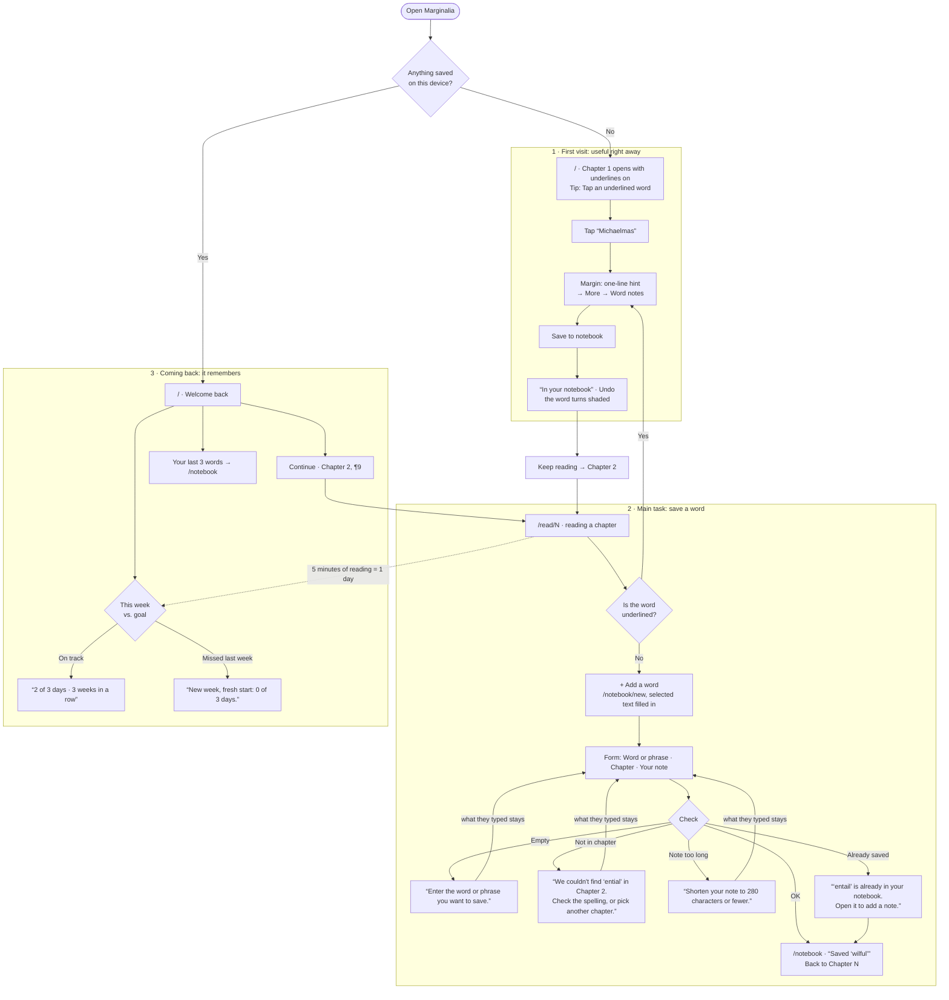

# Flows

**The main task, in one sentence:**
I tap a word I don't know → I see what it meant in 1813 and save it to my notebook →
I come back on Sunday, see my week, and pick up where I stopped.

## States

| State | What the reader sees |
|---|---|
| Loading saved data | A neutral page skeleton, never a flash of the first-visit screen |
| Notebook empty | "No words yet. Tap an underlined word in Chapter 1 to save it." and Start reading |
| Browser can't save (private mode, storage full) | "This browser isn't saving right now, so your words will be gone when you close the tab." |
| Chapter that doesn't exist (`/read/99`) | "Pride and Prejudice has 61 chapters." and a link to Contents |
| Saved data can't be read | Start fresh without crashing |
| Missed last week's goal | "Welcome back. New week, fresh start: 0 of 3 days." Continue reading stays on top |

## Pages

| Route | Step |
|---|---|
| `/` | First visit (Chapter 1) or Welcome back, decided once on load |
| `/read` | Contents |
| `/read/[chapter]` | Reading, with the margin |
| `/notebook/new` | The form: save a word |
| `/notebook` | The notebook |
